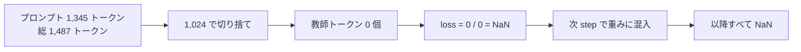

## はじめに

Anicca では、人の行動を予測して介入するモデル「Manager」のポストトレーニングを、AI エージェントのチームで回しています。学習も、失敗の切り分けも、記録も、エージェントが担当します。

2026-11-25、その学習が **2 回連続で、ほぼ同じ iter で NaN になりました**。学習率を半分にしても、発症位置は変わりませんでした。

この記事は、その原因を決定的に特定するまでの切り分けと、再発防止として入れたデータ構築ゲートの話です。結論を先に書くと、原因はモデルでも学習率でもなく、**プロンプトだけで 1,345 トークンあり、切り捨てで教師トークンが 0 個になった学習データ 1 件**でした。

## 学習の構成

| 項目 | 内容 |
| --- | --- |
| ベースモデル | mlx-community/gemma-2-2b-it（Gemma 2 2B） |
| 実行環境 | Mac mini（M4 / 16GB）、mlx-lm |
| 手法 | LoRA SFT（r=8） |
| 学習データ v1 | 1,828 件（社会科学の人間回答データ SocSci210 由来 1,771 件 + デジタルツインの返信ペア 57 件） |
| 系列長 | max_seq_length = 1,024 |

学習データは、人間の実験参加者の実回答と、創業者のメール返信ペア（デジタルツイン用）から作りました。held-out として 9 ペア（2,361 行）は学習から完全に分離し、評価専用に確保しています。

## 何が起きたか

| run | 学習率 | 経過 |
| --- | --- | --- |
| run 6 | 1e-5 | iter 30 で loss 2.320 → iter 70 で 1.124 と単調減少。その後 iter 100 前後で NaN 化 |
| run 7 | 5e-6（半減） | iter 80 で 1.395 まで順調。ほぼ同じ iter 帯で再び NaN |

学習率を変えても発症位置が同じ、というのが最初の手がかりでした。両 run は seed 42 で同一のデータ順だったので、「特定の example が発散を誘発している」疑いに絞りました。

## 切り分け: データの消費順序を再現する

mlx-lm がデータを消費する順序を、Mac 上でそのまま再現しました。

- 学習データは `CacheDataset` 経由で渡され、`iterate_batches` の長さソートは実質 no-op（ファイル順）
- 順序を決めるのは `np.random.seed(42)` の permutation のみ
- iter はバッチ単位（batch_size 1）

再現した順序で tokenize（Gemma tokenizer + `ChatDataset.process` の実物）したところ、学習ログに出ていた長さ警告の位置と完全一致しました（iter 91 = 1,487 トークン、iter 150 = 2,231 トークン、iter 187 = 2,123 トークン）。この一致で、再現が正しいことを検証しました。

容疑区間は iter 91–100。その先頭、**iter 91 の example が毒でした**。

## 原因: 0/0 = NaN

毒 example は学習ファイルの file_idx 324（デジタルツインの返信ペア。長いメールスレッドへの返信）です。

- 総トークン 1,487、うちプロンプトだけで **1,345 トークン**
- mlx-lm は系列を max_seq_length = 1,024 に切り捨てるため、教師トークン（assistant 応答分）が **0 個**になる
- mlx-lm の `default_loss` は、マスクされたクロスエントロピーの合計を教師トークン数で割る。つまり **0 / 0 = NaN**
- iter 91 で loss が NaN になり、次の optimizer step で重みに NaN が混入。以後すべて NaN

単体検証でも確認しました。素のベースモデル（LoRA なし）で file_idx 324 の loss は NaN（教師トークン 0）。同型の file_idx 931 も NaN。通常の SocSci 例（file_idx 70）は loss 16.32（教師トークン 4）で有限でした。因果はこれで確定です。学習率は無実でした。

## ついでに死んでいた checkpoint

run 6 が iter 100 で保存した checkpoint は、見た目どおりのファイルとして存在していました。しかし safetensors を全数検査すると、**6,389,760 要素の 100% が NaN**（Inf は 0、有限要素は 0）。NaN 化した後に保存されていたため、中身は完全に死んでいました。

「checkpoint が保存された」ことと「checkpoint が使える」ことは別物でした。以後、checkpoint は数値検査（NaN/Inf の件数と最大絶対値）を通してから使うことにしています。

## 修正: データ側のゲート

全データを tokenize 実測で走査すると、プロンプトが 1,024 トークン以上の例は **16 件**あり、全てデジタルツイン由来（長いメールスレッドへの返信）でした。SocSci 側は 0 件です。

- train v2: 16 件を除外した **1,812 件**（SocSci 1,771 + twin 41）。除外の内訳は sha256 つきで記録し、再現可能にした
- 検証集合は最大プロンプト 351 トークンで健全なため再利用
- held-out 9 ペアには一切触れていない

そして恒久対策として、データ構築のゲートを決めました。

> **mlx-lm に渡す前に「プロンプト長 ≥ max_seq_length の例が 0 件」を必ず実測する。判定は tokenize の実測で行い、文字数で代用しない。**

## run 8: 完走

train v2 で、NaN ウォッチドッグ（ログに nan が出たら即停止して記録）を併走させて run 8 を回しました。**ウォッチドッグの発動はゼロで、450 iter 完走しました。**

| iter | val loss | train loss |
| --- | --- | --- |
| 1 | 16.346 | — |
| 10 | — | 11.017 |
| 100 | 1.162（前回はここで NaN） | 0.993 |
| 200 | 0.530 | — |
| 300 | 0.462 | — |
| 400 | 0.508 | — |
| 450 | **0.459** | **0.373** |

新しい adapter は NaN 0 件・Inf 0 件・最大絶対値 0.0236 で健全でした。生成テストでも意味のある英文が返り、崩壊がないことを確認しています。

## まだ言えないこと

正直に書いておきます。

- 今回の SFT は 450 iter = 約 0.25 epoch 相当です。本番化するなら iter 数の増加（1 epoch = 1,812 iter 目安）が要ります
- **held-out 9 ペアでの adapter あり/なしの同一ハーネス採点は、まだ終わっていません**。ベースライン側の採点完走を待っている状態です
- したがって「学習でモデルが良くなった」とは、現時点では言いません。言えるのは「学習が完走し、checkpoint が健全で、生成が崩壊していない」までです

Manager の前バージョンは、ベースモデルにもランダムにも負ける負の結果でした。その出発点があるので、評価の数字が出るまでは改善を主張しないことにしています。

## 学んだこと

1. **NaN の切り分けは、ハイパーパラメータより先にデータの消費順序を再現する**。順序が決定的に再現できれば、容疑区間は iter 単位で絞れる。学習率を疑って 1 run 無駄にした
2. **checkpoint は保存されただけでは信用しない**。数値検査を通して初めて「使える成果物」と呼ぶ
3. **データのゲートは tokenize 実測で作る**。文字数ベースの目安は、今回のような境界ケースを素通りさせる

Anicca は、人の行動を予測するモデル（Manager）、その評価（ManagerBench）、介入アプリ（Anicca）を、AI エージェントのチームで開発している研究ラボです。学習ランも評価も、失敗したものも含めて記録を公開していきます。

- GitHub: https://github.com/Daisuke134/anicca
